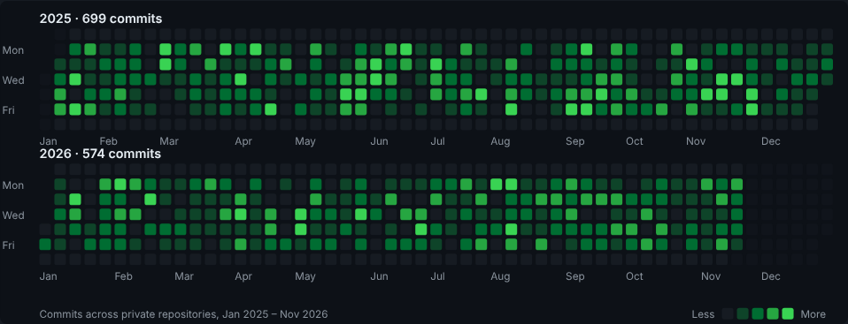

# Private Commit Heatmap

Most of my work lives in private client repositories, so my public GitHub graph looked empty. This tool turns daily commit counts from any set of repos into a GitHub-style heatmap SVG, without exposing commit messages, file names or code.

**Web version:** https://vishwadeep-solves-conflicts.github.io/private-commit-heatmap/ (runs in your browser; nothing is uploaded)



## 1. Export commit counts

The scripts write `commit_days.txt`, with one `<count> <YYYY-MM-DD>` line per day. That's all that leaves your repos.

```bash
# macOS / Linux
bash scripts/export_commit_days.sh "Your Name" 2024-01-01 ~/code/repo1 ~/code/repo2
```

```powershell
# Windows
.\scripts\export_commit_days.ps1 -Author "Your Name" -Since 2024-01-01 -Repos C:\code\repo1, C:\code\repo2
```

- `--author` is matched against name and email, ignoring case, so `jane` catches `Jane Doe <jane@work.com>`.
- Commits on every branch are counted, merges are skipped, and copies of the same commit (rebases, cherry-picks) are counted once, matched by author timestamp and subject. Without that step, rebased branches can double your numbers.

## 2. Make the SVG

**In the browser:** paste the file into the web version, pick a theme, and download.

**From the command line** (Python 3, standard library only):

```bash
python3 heatmap.py commit_days.txt -o out/                       # light + dark
python3 heatmap.py commit_days.txt -o out/ --theme custom \
  --colors "#0a3460,#1d5a78,#2b8a96,#46c1c0,#96ffff" --bg "#022449"
python3 heatmap.py commit_days.txt --caption "Commits at Acme, {start:%Y}–{end:%Y}"
```

You get one row per year with month labels, per-day tooltips, a yearly total and a Less/More legend. Colour levels come from your own distribution (quartiles of your active days), so one huge day doesn't wash out the rest.

## 3. Put it on your profile

```html
<picture>
  <source media="(prefers-color-scheme: dark)" srcset="commit-heatmap-dark.svg">
  
</picture>
```

You can see it on [my GitHub profile](https://github.com/vishwadeep-solves-conflicts) and [portfolio](https://vishwadeep-s.netlify.app).

## Working on the web version

It's a small React app built with Vite. You need Node 20 or newer.

```bash
npm install
npm run dev      # http://localhost:5173
npm run build    # production build in dist/
```

```
heatmap.py             the command-line version (standard library only)
scripts/               export_commit_days.sh and .ps1
src/
  lib/
    commits.ts         reading commit_days.txt and picking the colour levels
    heatmapSvg.ts      drawing the SVG
    palettes.ts        GitHub dark, GitHub light and custom colours for the SVG
    dates.ts, sampleData.ts, download.ts
  components/          one file per step on the page
  styles/              the page's own styles and theme colours
  shared/              theme switcher and top bar, the same in every app
  App.tsx              the page's state: pasted text, colours, caption
```

`heatmap.py` and `src/lib/heatmapSvg.ts` draw the same picture. If you change one, change the other.

Every push to `main` runs `.github/workflows/deploy.yml`, which builds the app and publishes `dist/` to the `gh-pages` branch. GitHub Pages serves that branch, and the self-hosted server copies it.

## Licence

MIT. Built by [Vishwadeep Kushwaha](https://vishwadeep-s.netlify.app).
